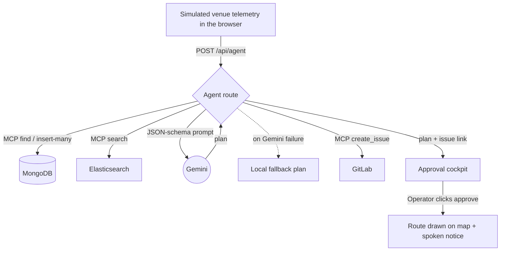

# OmniFlow AI

> A Next.js demo of an incident-triage agent: when a simulated venue anomaly appears, it gathers context through MCP servers, asks Gemini for a crowd-reroute plan, and shows the plan in an operator approval screen.

**Status:** Prototype with simulated telemetry. No digital signage or turnstile is actually controlled.
**Demo:** none linked yet. The app has no hosted instance; run it locally (see Quickstart).

---

## Architecture



- **Telemetry** is generated in the browser (`src/lib/mockGenerators.ts`) for a stadium-style venue graph and posted to `src/app/api/agent/route.ts`.
- **MCP:** the route starts MCP servers over stdio with `npx` (`mongodb-mcp-server`, `@elastic/mcp-server-elasticsearch`, `@modelcontextprotocol/server-gitlab`) and calls their tools. Each is skipped if its environment variables are not set.
- **Gemini** (`@google/genai`, model `gemini-3.1-flash-lite`) is asked for a JSON plan constrained by a response schema, with temperature 0.2. Up to four keys are tried in turn, each with a 20-second timeout.
- **Fallback:** if all Gemini calls fail, the route returns a fixed local plan and starts `gemini-auto-storage-cleaner.mjs` in the background.
- **Routing:** `src/lib/algorithms.ts` has a Dijkstra search (`findSafestEvacuationPath`) over the venue graph.
- **Approval:** clicking approve in `src/app/page.tsx` draws the proposed route on the map and plays a browser speech announcement. It does not call any external system.

## Quickstart

Requires Node.js 20.9 or newer (Next.js 16) and `npx` access to download the MCP servers.

```bash
git clone https://github.com/HamzaKhanBUIC/omniflow-ai.git
cd omniflow-ai
npm install
cp .env.example .env.local   # fill in values
npm run dev
```

Open http://localhost:3000. With only `GEMINI_API_KEY` set, the MongoDB, Elasticsearch and GitLab steps are skipped. With no Gemini key, the app returns the local fallback plan.

Other scripts: `npm run build`, `npm start`, `npm run clean:gemini` (runs `gemini-auto-storage-cleaner.mjs`). `npm run lint` runs `next lint`, which Next.js 16 no longer includes, so it does not work.

## Configuration

From `.env.example`, read in `src/app/api/agent/route.ts`:

| Variable | Required | Description |
| :-- | :-- | :-- |
| `GEMINI_API_KEY` | for live plans | Gemini API key |
| `GEMINI_API_KEY_2` ... `_4` | no | Backup Gemini keys, tried in order on failure |
| `MONGODB_CONNECTION_STRING` | no | Enables history lookup and saving via the MongoDB MCP server (database `stadium`, collection `history`) |
| `ELASTICSEARCH_URL`, `ELASTICSEARCH_API_KEY` | no | Both needed to enable the Elasticsearch search step |
| `GITLAB_PERSONAL_ACCESS_TOKEN` | no | Enables GitLab issue creation (token needs `api` scope) |

## Limitations

- **The GitLab issue is created before a human approves anything.** The route calls `create_issue` inside the POST handler (`route.ts`, GitLab block), before the operator sees the plan. Only the on-screen "execution" step waits for the approve click. The issue body says the action was "taken" even though nothing has been approved.
- **The GitLab project is hard-coded** as `HamzaKhanBUIC/omniflow-ai` in `route.ts`. Change it before using your own token.
- **No authentication or rate limiting on `/api/agent`.** Anyone who can reach the route can trigger Gemini calls and GitLab issues. Do not expose it publicly with real keys.
- **Most of the "telemetry" is canned.** The Dynatrace, Fivetran and Arize values and the default MongoDB, Elasticsearch and GitLab responses are hard-coded JSON strings in `route.ts`; real MCP results replace them only when the matching variables are set. The Elasticsearch call is `match_all` on `*`.
- **Unvalidated data goes into prompts and issues.** MCP results are interpolated into the Gemini prompt and the GitLab issue text without sanitising.
- **The "confidence" text is a label,** not a measured value (`Live Deduction (100%)` and `Local Failover Model (85%)` are fixed strings).
- **The fallback is not a model.** It returns a template message and the first other node in the graph as the route.
- **No tests, no Dockerfile.** The repo has none, so there is no tested container build. The earlier Cloud Run commands in this README were removed because `gcloud builds submit --tag` needs a Dockerfile.
- **The Gemini model ID** `gemini-3.1-flash-lite` was not re-checked against the current Google model list.
- `check-mongo.mjs` and `gemini-auto-storage-cleaner.mjs` are helper scripts at the repo root.

## License

MIT. See [LICENSE](LICENSE).
